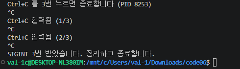
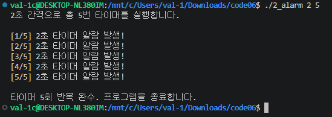
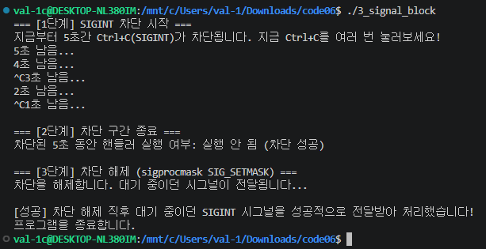

1_sigint.c 프로젝트의 경우 반복으로 누른 횟수를 카운트를 하는 프로젝트이다.
2_alarm.c 프로젝트의 경우 일정한 간격을 기다리며 n회 반복을 하는 타이머 프로젝트이다.
3_signal_block.c 프로젝트의 경우 특정 구간 동안 시그널을 차단하고, 차단 해제 시 대기 중이던 시그널이 전달되는지 확인하는 프로젝트이다.

## 실행 화면 캡처

### 1_sigint 실행 결과

### 2_alarm 실행 결과

### 3_signal_block 실행 결과

AI 사용 관련 내용과 본인의 보강 내용
AI 사용 내용
1. 해당 .c코드를 실행을 하려 하지만 계속해서 오류가 나와 문제점을 해결
2. 2번 코드의 일부와 3번 코드 전체를 도움 받음

보강 내용
1. 해당 프로그램이 어째서 작동을 안하는지에 대한 이해가 필요함을 보임
2. 여전히 코드에 대해서 이해가 안되는 부분이 있어 보이므로 공부가 부족함이 보임
